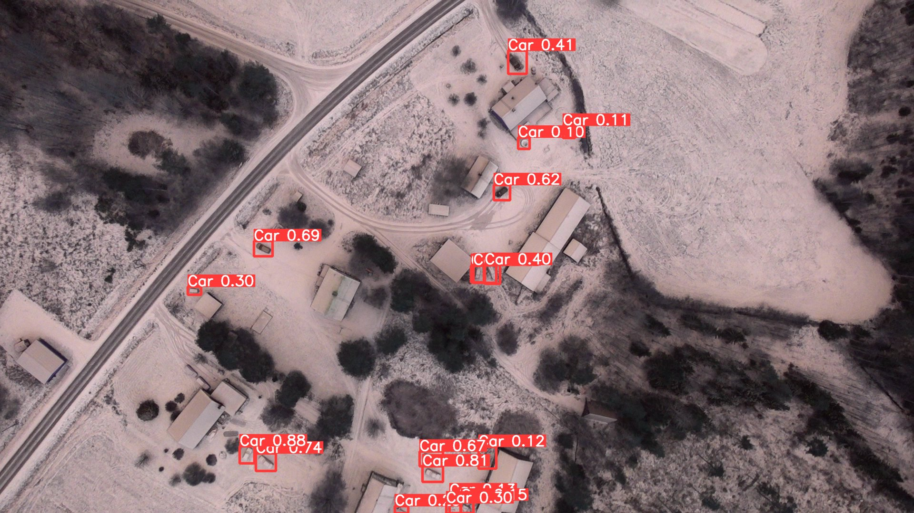
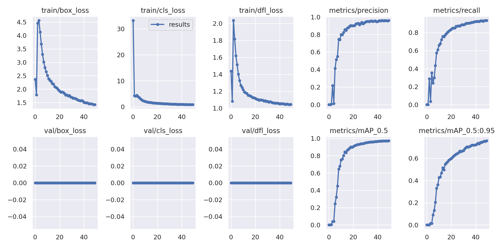
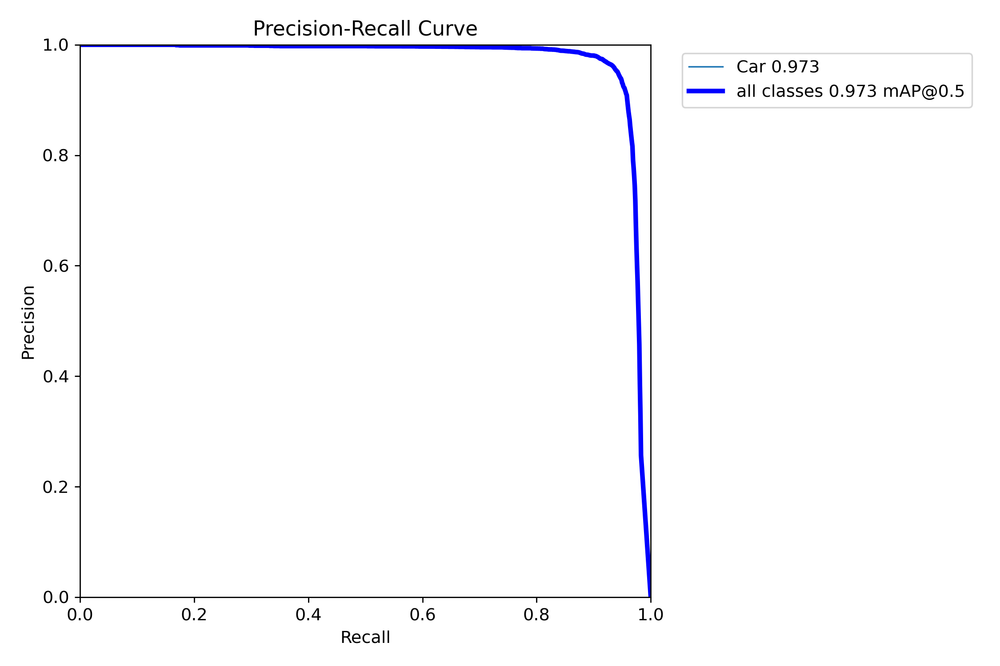
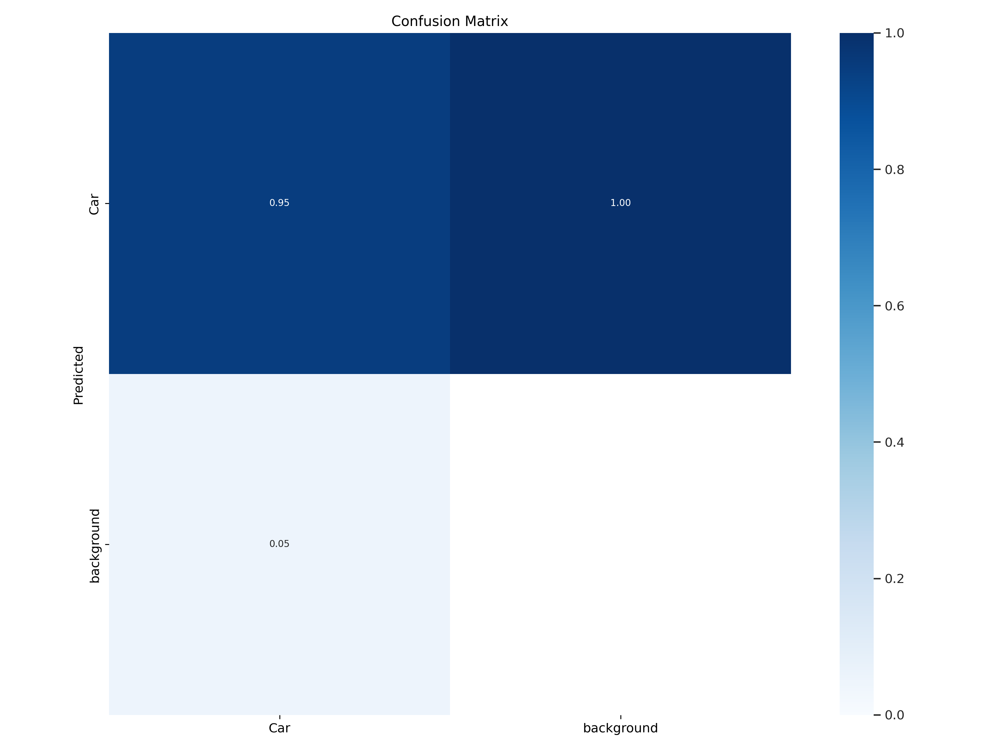
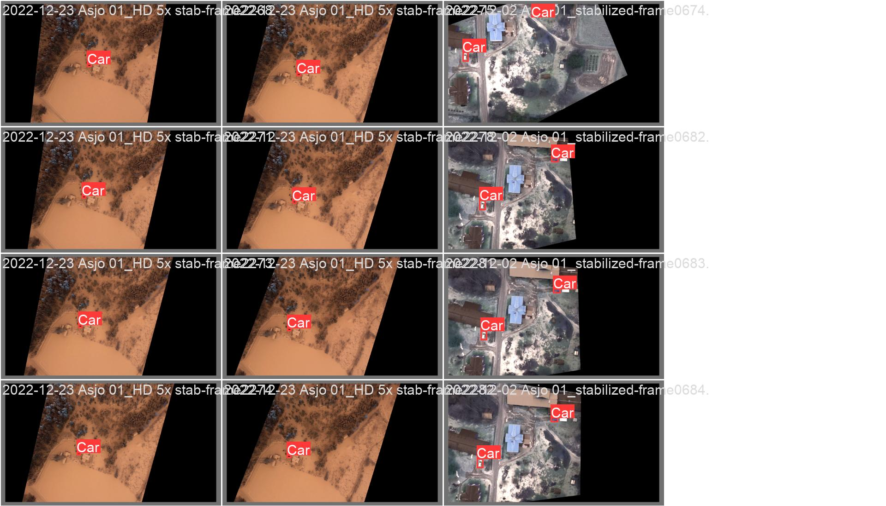
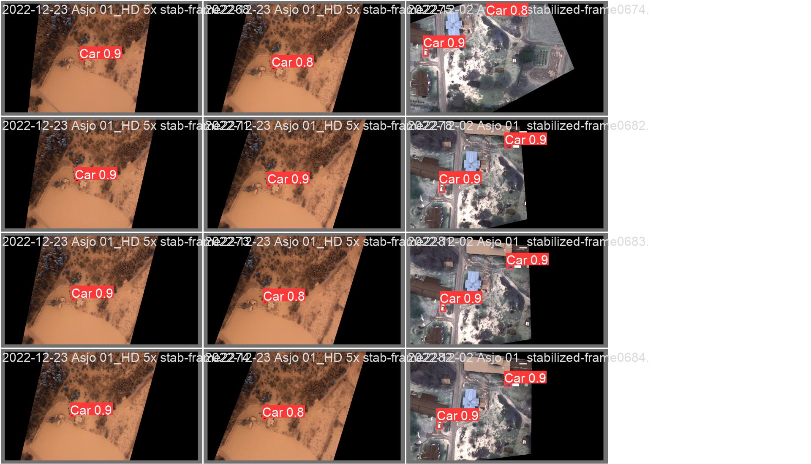

# Vehicle Detection in Nordic Drone Footage with YOLOv9

Fine-tuning **YOLOv9-E** to detect cars in aerial drone video of snowy rural Sweden, a hard setting where small vehicles blend into snow, shadows and rooftops.

> Group project for *Advanced Deep Learning (D7047E)*, Luleå University of Technology, May 2024. Built by Group 7; see [Team](#team).



## Highlights

- **0.973 mAP@0.5** and **0.757 mAP@0.5:0.95** on the validation set after 50 epochs.
- **Precision 0.96, recall 0.93** for the single `Car` class.
- **Clear before/after story:** an off-the-shelf pretrained detector produced mostly false positives and missed cars, and domain fine-tuning fixed that.

## Problem

Generic object detectors are trained mostly on street-level photos. From a drone looking straight down in winter, cars are a few dozen pixels across, often half-covered by snow, and easily confused with sheds, trailers and shadows. The goal was to build a detector that works reliably in these Nordic conditions.

## Data

The [Nordic Vehicle Dataset (NVD)](https://nvd.ltu-ai.dev), "Labeled Frames" set, YOLO format: drone video frames from several Swedish locations (Åsjö, Nyland, Bjenberg) with bounding boxes for cars.

| Split | Frames |
|---|---|
| Train | 4,354 |
| Validation | 2,903 |
| Test | 1,190 |

The split lists are in [`data/splits/`](data/splits). The images themselves (about 24 GB) are not stored here; the notebook downloads them.

## Approach

**1. Baseline (in [`experiments/`](experiments))**
Ran a pretrained YOLOv9-E through Ultralytics with no fine-tuning, then added confidence thresholds, augmentation and precision/recall/mAP measurement. Results were poor, with many false positives and false negatives, which motivated fine-tuning.

**2. Fine-tuning (in [`notebooks/`](notebooks))**
- Official [YOLOv9](https://github.com/WongKinYiu/yolov9) implementation, `train_dual.py`, starting from COCO-pretrained `yolov9-e.pt`.
- Custom single-class model config ([`configs/yolov9_custom.yaml`](configs/yolov9_custom.yaml)).
- 50 epochs, batch size 6, 640 px images, SGD (lr 0.01, momentum 0.937), on a GPU.
- Heavy augmentation for small, varied objects: mosaic, MixUp (0.15), copy-paste (0.3), scale (0.9), HSV jitter and horizontal flips ([`configs/hyp.scratch-high.yaml`](configs/hyp.scratch-high.yaml)).

## Results

| Epoch | mAP@0.5 | mAP@0.5:0.95 |
|---|---|---|
| 10 | 0.678 | 0.361 |
| 20 | 0.897 | 0.589 |
| 30 | 0.945 | 0.665 |
| **50** | **0.973** | **0.757** |



<p>


</p>

Ground truth (left) versus predictions (right) on a validation batch:

<p>


</p>

More detections on full frames are in [`results/examples/`](results/examples).

### Observations

- **Still improving at epoch 50.** mAP@0.5:0.95 was still climbing, so a longer schedule would likely tighten the boxes further.
- **Low-confidence detections need a threshold.** On full-resolution frames the model fires on some sheds and shadows at confidence 0.1–0.3; choosing an operating threshold from the F1 curve removes most of these.
- **Training logs:** validation losses log as zero with `train_dual.py`, a known quirk of the logging in that script. The validation metrics above are computed normally.

## Repository structure

```
├── notebooks/
│   └── yolov9_finetune_nvd.ipynb   # setup, dataset download, fine-tuning, inference
├── experiments/                    # pretrained baseline attempts
├── configs/                        # dataset, model, hyperparameter and run configs
├── data/splits/                    # train/val/test frame lists
└── results/                        # metrics CSV, curves, validation batches, example detections
```

## Running it

You need a CUDA GPU. Then follow the notebook, which:

1. Downloads the NVD "Labeled Frames (YOLO format)" archive.
2. Downloads the YOLOv9 repository and the `yolov9-e.pt` weights.
3. Trains with the configs in `configs/`.

```bash
python yolov9-main/train_dual.py --workers 12 --batch 6 --img 640 --epochs 50 \
  --data configs/data.yaml --weights data/models/yolov9-e.pt \
  --cfg configs/yolov9_custom.yaml --hyp configs/hyp.scratch-high.yaml --device 0
```

## Team

Group 7, D7047E Advanced Deep Learning: **Aamer Barood** and teammates. The original group repository, with full commit history and per-member contributions, is [Gabmyr/D7047E-Labs-Group-7](https://github.com/Gabmyr/D7047E-Labs-Group-7).

Dataset: Nordic Vehicle Dataset, Luleå University of Technology. Model: [YOLOv9](https://github.com/WongKinYiu/yolov9) by Wang, Yeh and Liao.
